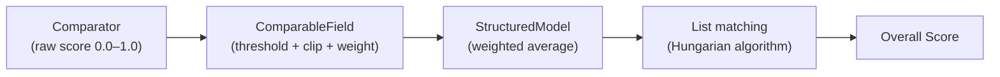

# Customizing Your Evaluation

Stickler gives you fine-grained control over how every field in your structured data is compared. You can tune comparison algorithms, thresholds, and weights at the field level -- whether you define your models in Python or through JSON Schema configuration files.

This guide covers four ways to configure evaluation behavior:

1. **Inference from a Pydantic class** — no configuration at all; `stickler.evaluate` picks a comparator and threshold per field from the type and field name. Start here if you already have a model
2. **ComparableField parameters** in Python model definitions
3. **The `compare_with()` method** for running comparisons
4. **JSON Schema extensions** for configuration-driven evaluation

Options 1 and 4 are independent paths that infer differently, not two steps of one workflow — see [Choosing a Configuration Path](../../Getting-Started/choosing-a-configuration-path.md).

!!! tip "Evaluating a test set?"
    If you need to evaluate many document pairs (not just one), use **`BulkStructuredModelEvaluator`** — it handles streaming aggregation, progress reporting, and metrics export. See the [Bulk Evaluation](bulk-evaluation.md) guide.

!!! tip "Evaluating confidence scores?"
    If your model produces confidence scores alongside predictions, see the [Confidence Evaluation](confidence-evaluation.md) guide for AUROC, Brier Score, ECE, and Error Capture at Review Budget metrics.

!!! tip "Evaluating bounding boxes?"
    If your model returns bounding boxes (via the `_bbox` rich-value key), see the [Bounding Box mAP Metrics](../../Advanced/bbox-map-metrics.md) page for COCO-style mean Average Precision over a configurable IoU-threshold range.

---

## How Evaluation Works

Stickler evaluates structured data from the inside out. At the innermost layer, **Comparators** compute a raw similarity score (0.0–1.0) between two primitive values. Each **ComparableField** wraps a comparator with a threshold and weight — scores below the threshold are clipped to zero, and weights control how much the field matters. **StructuredModels** aggregate field scores into a weighted average. For list fields, the **Hungarian algorithm** finds the optimal one-to-one pairing between ground truth and prediction items before scoring.



---

## ComparableField Parameters

When defining a `StructuredModel` subclass in Python, each field is declared with `ComparableField(...)`. This function accepts comparison parameters that control how that specific field is evaluated.

### Parameter Reference

| Parameter | Type | Default | Description |
|-----------|------|---------|-------------|
| `comparator` | `BaseComparator` | `LevenshteinComparator()` | The comparison algorithm to use. See [Comparators](../Comparators/README.md) for the full list. |
| `threshold` | `float` (0.0--1.0) | `0.5` | Minimum similarity score required for a field to be classified as a match. |
| `weight` | `float` (> 0.0) | `1.0` | Relative importance of this field when computing aggregate scores. |
| `clip_under_threshold` | `bool` | `True` (`False` on dict and plain-model fields, lists of them, and `List[StructuredModel]`) | When `True`, scores below `threshold` are zeroed out before contributing to the weighted average. List fields follow the [Score](../../Advanced/classification-logic.md#list-contract) rule of the list contract, which also covers a list of models spelled another way, such as `List[Union[...]]`, `List[Any]` or `Sequence[...]`. |

### How Each Parameter Affects Scoring

**`comparator`** -- Determines which algorithm computes the raw similarity score between two field values. Different comparators suit different data types:

- `LevenshteinComparator` for names and addresses (edit-distance based)
- `ExactComparator` for IDs and codes (binary match)
- `NumericComparator` for prices and quantities (tolerance-based)
- `FuzzyComparator` for descriptions (token-based, order-independent)

See the [Comparators](../Comparators/README.md) section for the complete list and detailed descriptions.

**`threshold`** -- Acts as a binary classification cutoff. A similarity score at or above the threshold counts as a True Positive; below it counts as a False Discovery. See [Meeting a Threshold](../../Getting-Started/thresholds-and-metrics.md#meeting-a-threshold). Choose stricter thresholds (0.9--1.0) for critical fields and looser thresholds (0.5--0.7) for flexible fields. The field's threshold, set here or adopted from the comparator, must be a number from 0.0 to 1.0; anything else raises `ValueError` when the class is defined. An `Annotated` field that names something defined further down, its type or a value in its `ComparableField(...)`, is not yet checked at class definition when its annotation is a string, as every annotation is under `from __future__ import annotations`. The message reads:

```text
ValueError: Invalid threshold for field 'vendor' of model 'Invoice': ComparableField(threshold=85) is out of range. A threshold is the minimum similarity score for a match, from 0.0 to 1.0. 85 is above 1.0, so even identical values would not match. If 85 is a percentage, write ComparableField(threshold=0.85). (Set at invoice_models.py:5.)
```

See [Valid Threshold Values](../../Getting-Started/thresholds-and-metrics.md#valid-threshold-values).

**`weight`** -- Controls how much a field contributes to the overall score. The overall score is computed as:

```
overall_score = sum(field_score * weight) / sum(weights)
```

Fields with higher weights pull the overall score toward their individual result. At the dataset level, `BulkStructuredModelEvaluator.compute()` exposes this weight-aware aggregate as `metrics["weighted_overall_score"]` -- prefer it over `cm_f1` when weights are non-uniform, since `cm_f1` treats every field-match equally. See [Weighted Overall Score](bulk-evaluation.md#weighted-overall-score) in the bulk-evaluation guide.

**`clip_under_threshold`** -- When enabled (the default, except on dict and plain-model fields), a field that scores below its threshold contributes 0.0 to the weighted average instead of its partial similarity. This prevents low-confidence matches from inflating the overall score. A list field follows the [Score](../../Advanced/classification-logic.md#list-contract) rule of the list contract instead.

### Example Model

```python
from stickler import (
    ComparableField,
    ExactComparator,
    FuzzyComparator,
    LevenshteinComparator,
    NumericComparator,
    StructuredModel,
)


class Invoice(StructuredModel):
    invoice_id: str = ComparableField(
        comparator=ExactComparator(),  # Must match exactly
        threshold=1.0,
        weight=3.0,                    # Highest weight — wrong ID = wrong customer
        clip_under_threshold=True,
    )

    customer_name: str = ComparableField(
        comparator=LevenshteinComparator(),  # Tolerates typos
        threshold=0.8,
        weight=1.5,
    )

    total_amount: float = ComparableField(
        comparator=NumericComparator(absolute_tolerance=0.01),  # Equal within 0.01
        weight=2.5,
    )

    notes: str = ComparableField(
        comparator=FuzzyComparator(),  # Low threshold, minimal weight — cosmetic field
        threshold=0.6,
        weight=0.3,
    )
```

---

## The `compare_with()` Method

Once you have two model instances -- a ground truth and a prediction -- call `compare_with()` to evaluate them.

### Basic Usage

```python
result = ground_truth.compare_with(prediction)

print(f"Overall score: {result['overall_score']:.2%}")

for field, score in result['field_scores'].items():
    print(f"  {field}: {score:.3f}")
```

The default output contains two keys:

- **`overall_score`** (float) -- Weighted average of all field scores (0.0 to 1.0).
- **`field_scores`** (dict) -- Maps each field name to its similarity score.

### Key Parameters

| Parameter | Type | Default | What It Enables |
|-----------|------|---------|-----------------|
| `include_confusion_matrix` | `bool` | `False` | Adds a `confusion_matrix` key with TP/FP/TN/FN/FD/FA counts and derived precision, recall, F1, and accuracy metrics at both the overall and field levels. |
| `document_non_matches` | `bool` | `False` | Adds a `non_matches` list with details about every field that failed to match, including the field path, non-match type, both values, and a human-readable reason. |
| `document_field_comparisons` | `bool` | `False` | Adds a `field_comparisons` list documenting every field-level comparison (both matches and non-matches) with expected/actual keys and values, scores, and reasons. |
| `add_confidence_metrics` | `bool` | `False` | Adds a `confidence_metrics` dict with `overall`, `fields`, and `coverage` keys, using the configured metrics (AUROC by default). Auto-enables `document_field_comparisons` so the field-level join data is available. |
| `add_bbox_metrics` | `bool` | `False` | Adds a `bbox_metrics` dict with `mean_ap`, `map_50`, `map_75`, per-field AP, and `coverage`, using bounding boxes from the `_bbox` rich-value key. Auto-enables `document_field_comparisons`. Single-document mAP is a sanity check; emits a warning recommending `BulkStructuredModelEvaluator` with `BBoxMAPAccumulator` for meaningful results. |
| `bbox_iou_thresholds` | `float \| Iterable[float] \| None` | `None` | IoU threshold(s) for mAP. Defaults to the COCO range `(0.50, 0.55, ..., 0.95)`; pass a single float for a single-threshold `mean_ap` (equal to `map_50`). Only used when `add_bbox_metrics=True`. |
| `evaluator_format` | `bool` | `False` | Restructures the output for bulk evaluation integration. See [Evaluator Format](#evaluator-format) below. |

### Example with Detailed Metrics

```python
result = ground_truth.compare_with(
    prediction,
    include_confusion_matrix=True,
    document_non_matches=True,
)

# Overall score
print(f"Score: {result['overall_score']:.3f}")

# Confusion matrix totals
cm = result['confusion_matrix']['aggregate']
print(f"Precision: {cm['derived']['cm_precision']:.3f}")
print(f"Recall:    {cm['derived']['cm_recall']:.3f}")
print(f"F1:        {cm['derived']['cm_f1']:.3f}")

# Inspect non-matches for debugging
for nm in result.get('non_matches', []):
    score = nm.get('similarity_score')  # false discoveries only
    print(f"  {nm['field_path']}: {nm['non_match_type']}"
          + (f" (score={score:.3f})" if score is not None else ""))
```

---

## JSON Schema Extensions

For configuration-driven evaluation -- where you want to define models and comparison logic without writing Python code -- Stickler supports standard JSON Schema (Draft 7+) with custom `x-aws-stickler-*` extensions.

### Extension Reference

Add these extensions to any property in your JSON Schema to control comparison behavior:

| Extension | Type | Default | Purpose |
|-----------|------|---------|---------|
| `x-aws-stickler-comparator` | string | Type-dependent | Comparison algorithm (e.g., `"ExactComparator"`, `"LevenshteinComparator"`). On an object with `properties`, which is scored field by field, it has no effect except for a threshold it names, and warns |
| `x-aws-stickler-threshold` | number (0.0--1.0) | see below | Match classification cutoff. Read on a scalar, an object, and an array of scalars. **Ignored on an array of models** -- an array whose `items` declare `properties` -- where pairing is gated by the element class's `x-aws-stickler-match-threshold`, and a declared value from 0.0 to 1.0 other than 0.5 warns there (in Python, `ComparableField(threshold=...)` on a `List[StructuredModel]` raises `ValueError`); any other value raises, naming `x-aws-stickler-match-threshold`. Read, not ignored, on an array of free-form `{"type": "object"}` items |
| `x-aws-stickler-weight` | number (> 0.0) | 1.0 | Field importance multiplier |
| `x-aws-stickler-clip-under-threshold` | boolean | `true`; `false` on a free-form object, an array of them, or an array of models | Zero out scores below threshold. An inferred property takes it from inference (see below) |
| `x-aws-stickler-model-name` | string | `"DynamicModel"` | Name of the generated Python class (root level) |
| `x-aws-stickler-match-threshold` | number (0.0--1.0) | 0.7 | Model-level matching threshold for Hungarian algorithm (root level) |
| `x-aws-stickler-infer-unspecified` | boolean | `false` | Infer a comparator, threshold, weight and clip setting for any property that names none, using the same rules `stickler.evaluate()` uses (root level) |
| `x-aws-stickler-comparator-config` | object | `{}` | Keyword arguments passed to the named comparator. On an object with `properties` only its `threshold` is read; on an array of models nothing is. Every key not read warns |

An unstated `x-aws-stickler-threshold` does not resolve to one number. It depends
on the position, because different positions fall back to different defaults:

| Position | Default threshold | Where it comes from |
|---|---|---|
| plain scalar (`string`, `number`, ...) | `0.5` | `ComparableField`'s own default |
| object with `properties` (a nested model) | `0.7` | a fixed importer default; the nested class's own `x-aws-stickler-match-threshold` does not change it |
| free-form `{"type": "object"}` (a `Dict`), or an array of them | `1.0` | the mapping default |
| array of plain scalars | `0.5` | `ComparableField`'s own default |
| array of models | `0.5`, and never read from the schema | the element class's `match_threshold` gates instead |
| `enum` or `const` on any type, or a string `format` of `date`/`date-time`/`uri`/`uuid`/`time`, on the property or its array `items` | `1.0` | the type that keyword parses to, even when a comparator is declared |

A scalar is plain when it has none of the keywords in the last row. Any other
`format` (`email`, `hostname`, ...) leaves it plain. Declaring the key explicitly
overrides the default in every position that reads it. Without it, a threshold
named on the comparator, in `x-aws-stickler-comparator-config` or by a custom
comparator's constructor, overrides the default instead, as it does on the
Python path. Whichever the field uses must be a number from 0.0 to 1.0;
any other value raises `ValueError` on import, quoting the key as written:

```text
ValueError: Invalid threshold for field 'total' of model 'Invoice': the field sets no "x-aws-stickler-threshold", so it adopts its comparator's: "x-aws-stickler-comparator-config": {"threshold": 85}. A threshold is the minimum similarity score for a match, from 0.0 to 1.0. 85 is above 1.0, so even identical values would not match. If 85 is a percentage, write "x-aws-stickler-comparator-config": {"threshold": 0.85}, or "x-aws-stickler-threshold": 0.85 on the property, which wins over the comparator's.
```

When `x-aws-stickler-threshold` is set, the comparator's threshold is not read
and not checked. See [Valid Threshold Values](../../Getting-Started/thresholds-and-metrics.md#valid-threshold-values).

`x-aws-stickler-clip-under-threshold` defaults to `true`, except on a free-form
object or an array of them, where it defaults to `false` so a comparator such as
`ANLSStarComparator` keeps its partial credit. The default `ExactComparator`
scores each object `0.0` or `1.0`, so clipping does not change them. On an array
of models it also defaults to `false`, so an item below the element class's
`x-aws-stickler-match-threshold` keeps its partial score; set it to `true` to
score such an item `0.0`.

With `x-aws-stickler-infer-unspecified`, a scalar, a free-form object, or an
array of either that names no comparator takes any threshold or clip setting it
leaves unstated from
[inference](../../Advanced/dynamic-models.md#what-inference-chooses) instead.
Inference turns clip off for a free-form object, a free-text string such as
`notes` or `description`, and an array of either, and leaves it on elsewhere.

### Example Schema

```json
{
  "type": "object",
  "x-aws-stickler-model-name": "Invoice",
  "x-aws-stickler-match-threshold": 0.75,
  "properties": {
    "invoice_id": {
      "type": "string",
      "x-aws-stickler-comparator": "ExactComparator",
      "x-aws-stickler-threshold": 1.0,
      "x-aws-stickler-weight": 3.0,
      "x-aws-stickler-clip-under-threshold": true
    },
    "customer_name": {
      "type": ["string", "null"],
      "x-aws-stickler-comparator": "LevenshteinComparator",
      "x-aws-stickler-threshold": 0.8,
      "x-aws-stickler-weight": 1.5
    },
    "total_amount": {
      "type": ["number", "null"],
      "x-aws-stickler-comparator": "NumericComparator",
      "x-aws-stickler-comparator-config": {"absolute_tolerance": 0.01},
      "x-aws-stickler-weight": 2.5
    }
  },
  "required": ["invoice_id", "customer_name", "total_amount"]
}
```

The two fields that a document may not show are typed `["string", "null"]` and `["number", "null"]`. A field listed in `required` and typed `"string"` alone raises `ValidationError` when the value is genuinely `None`, so a schema that omits `"null"` fails on exactly the documents that test absence handling. `invoice_id` keeps its bare `"string"`: an invoice without an identifier is a broken record, not an absent field.

### Loading a Schema

```python
from stickler import StructuredModel
import json

with open("invoice_schema.json") as f:
    schema = json.load(f)

Invoice = StructuredModel.from_json_schema(schema)

ground_truth = Invoice(**{"invoice_id": "INV-001", "customer_name": "Acme Corp", "total_amount": 1250.00})
prediction = Invoice(**{"invoice_id": "INV-001", "customer_name": "ACME Corporation", "total_amount": 1250.00})

result = ground_truth.compare_with(prediction)
print(f"Overall Score: {result['overall_score']:.3f}")
```

??? example "Sample Output"

    ```json
    {
      "field_scores": {
        "invoice_id": 1.0,
        "customer_name": 0.0,
        "total_amount": 1.0
      },
      "overall_score": 0.786
    }
    ```

    Note that `customer_name` scores 0.0: "Acme Corp" vs "ACME Corporation" produces a Levenshtein similarity below the 0.8 threshold, so `clip_under_threshold` zeros it out.

Per-extension detail, default comparators by type, and a full production example are in the [JSON Schema Extensions](https://github.com/awslabs/stickler#json-schema-extensions-x-aws-stickler--complete-reference) section in the project README.

---

## Evaluator Format

When you need output structured for bulk evaluation pipelines, pass `evaluator_format=True`. This restructures the result into a format optimized for aggregation.

```python
result = ground_truth.compare_with(
    prediction, evaluator_format=True, document_non_matches=True
)
```

For the `ground_truth` and `prediction` above, where `customer_name` is a false discovery, the output changes to:

```json
{
  "overall": {
    "precision": 0.667,
    "recall": 1.0,
    "f1": 0.8,
    "accuracy": 0.667,
    "anls_score": 0.786
  },
  "fields": {
    "invoice_id": { "precision": 1.0, "recall": 1.0, "f1": 1.0, "accuracy": 1.0, "anls_score": 1.0 },
    "customer_name": { "precision": 0.0, "recall": 0.0, "f1": 0.0, "accuracy": 0.0, "anls_score": 0.0 },
    "total_amount": { "precision": 1.0, "recall": 1.0, "f1": 1.0, "accuracy": 1.0, "anls_score": 1.0 }
  },
  "confusion_matrix": {},
  "non_matches": [
    {
      "field_path": "customer_name",
      "non_match_type": "false_discovery",
      "ground_truth_value": "Acme Corp",
      "prediction_value": "ACME Corporation",
      "similarity_score": 0.5625,
      "details": { "reason": "below threshold (0.562 < 0.8)" }
    }
  ]
}
```

Key differences from the default output:

- The top-level key is `overall` (a dict of metrics), not `overall_score` (a float).
- `overall`, and the `overall` of each list field, take precision, recall, F1 and accuracy from the confusion counts, as in [Derived Metrics](understanding-results.md#derived-metrics), so they equal that node's `derived` block whether or not `include_confusion_matrix=True` was passed. The false discovery above counts as an FP, so it lowers precision, not recall (`recall_with_fd=True` counts it in recall too). This needs at least one TP, FP or FN: a node with none (both sides empty) keeps the score conversion below, except that `overall` reads `derived` when `include_confusion_matrix=True` (precision, recall and F1 `0.0`, accuracy `1.0`). `anls_score` is the score.
- A list field nests that `overall` beside per-item `items` (filled for a list of models). Which shape a field gets follows the ground-truth value: a list field whose ground truth is `None` comes back flat, with converted metrics.
- Any other field's metrics are a conversion of its score, not counts: a score of at least 0.5 reads precision equal to the score and recall `1.0`, a lower one `0.0` for both. `customer_name` scores `0.0`, so reads `0.0`; a true positive at `0.94` would read precision `0.94`.
- `confusion_matrix` is `{}` unless `include_confusion_matrix=True`.
- `non_matches` holds the records only with `document_non_matches=True`. Without it, it is `[]`, as in 1.0.0, because no records were collected, not because none were found, and a `DeprecationWarning` says so once per process. The printers and the HTML report cannot tell the two apart for evaluator-format output and print "No non-matches found" until 1.1.0, which omits the key, as the default output does.

This format is what `BulkStructuredModelEvaluator` expects when aggregating results across many documents.

---

## Next Steps

- [Bulk Evaluation](bulk-evaluation.md) -- Evaluate hundreds or thousands of document pairs with memory-efficient streaming.
- [Understanding Results](understanding-results.md) -- Learn how to read confusion matrices, derived metrics, and non-match reports.
